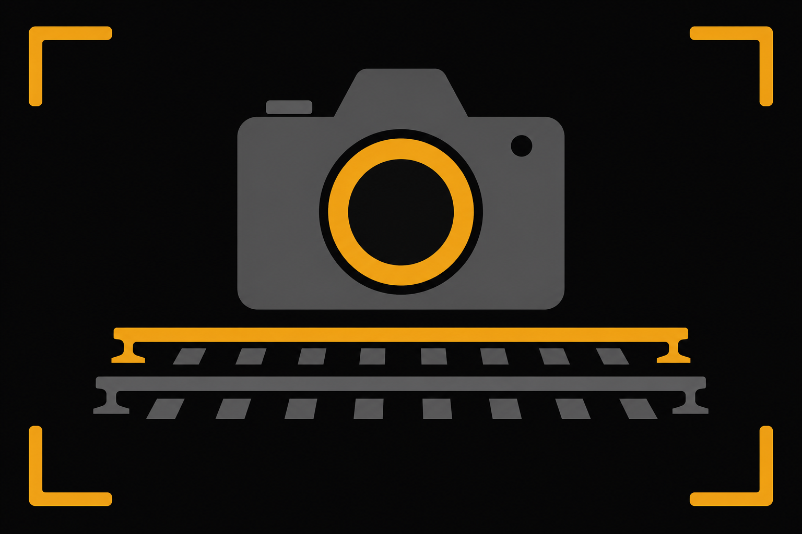
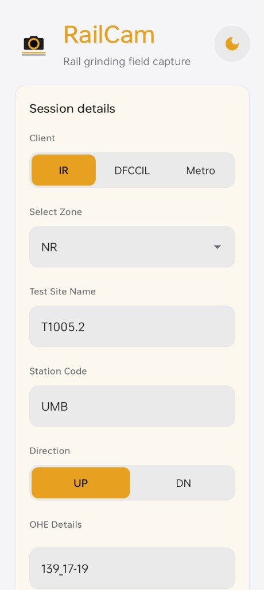
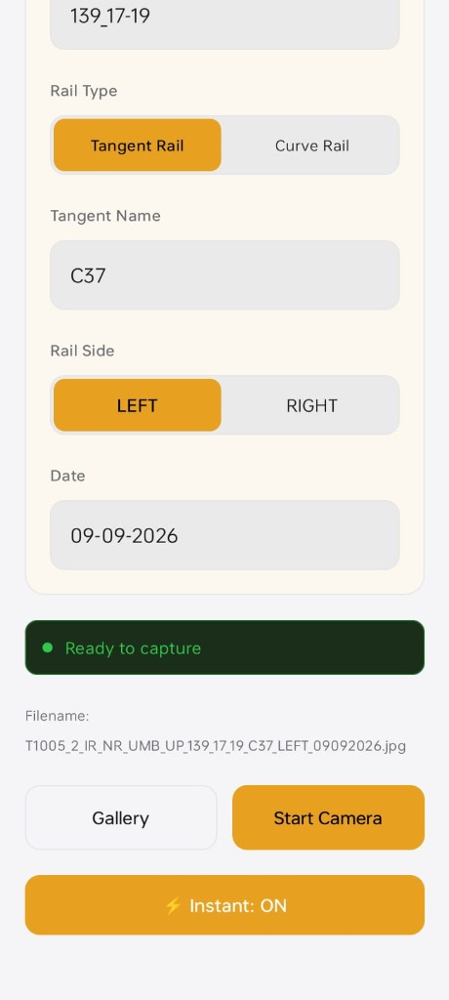
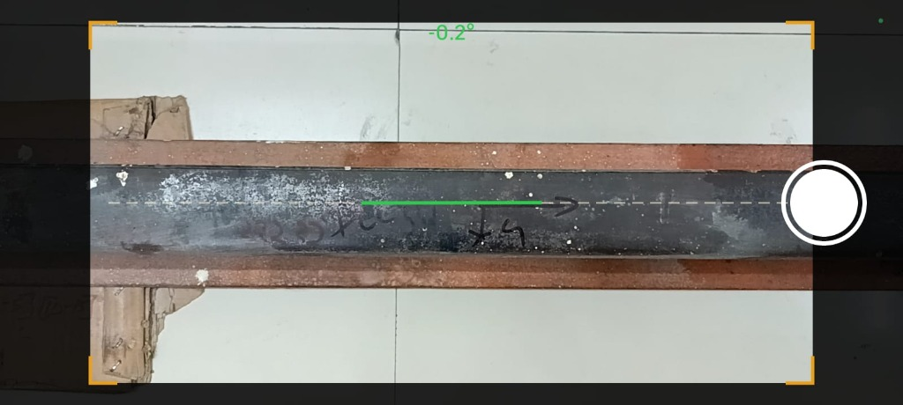
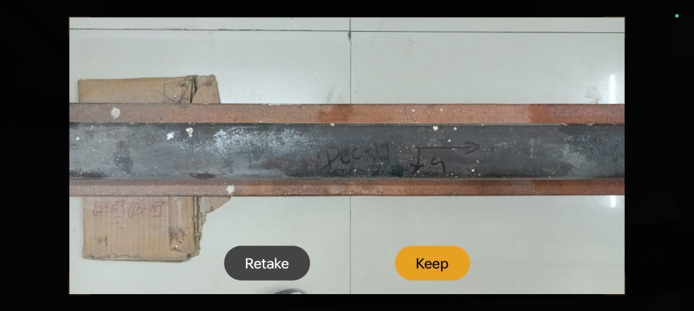
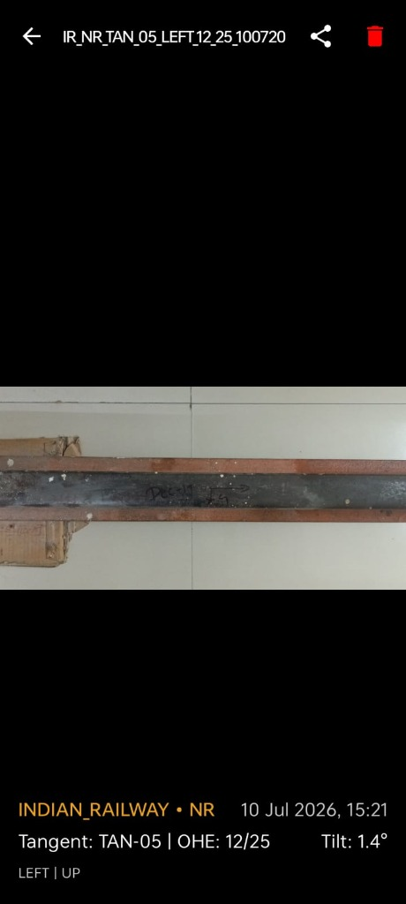

# 🚆 RailCam Kotlin

<p align="center">
  
</p>

<p align="center">
  <b>Professional Rail Grinding Inspection & Metadata-Tagged Field Capture Android Application</b>
</p>

<p align="center">
  <a href="https://github.com/rishavm003/RailCam_Kotlin/releases">
    
  </a>
  <a href="https://github.com/rishavm003/RailCam_Kotlin/releases">
    
  </a>
</p>

---

## 📌 Overview

**RailCam** is a high-precision, offline-first Android application custom-built for railway engineers, rail grinding inspectors, track maintenance personnel, and quality control teams (e.g., Indian Railways, DFCCIL, Metro Rail networks).

During rail grinding and track maintenance field operations, capturing accurately documented photo evidence is crucial for compliance, auditability, structural integrity reporting, and profile grinding quality control. Standard camera apps fail to enforce strict naming conventions, pitch/tilt alignment, dynamic metadata embedding, or offline persistence. 

**RailCam** bridges this gap by automatically recording standardized metadata with every captured image, calculating real-time device level/tilt angle, generating standardized file names, and providing seamless offline-first document sharing capabilities.

---

## 📷 App Screenshots & Workflow Showcase

| 1. Session Setup (Top) | 2. Session Setup (Bottom) | 3. Live Level-Guide Camera |
| :---: | :---: | :---: |
|  |  |  |
| **Preset Field Configuration** | **Real-time Filename Generator** | **Real-Time Tilt Sensor & Rail Mask** |

<br/>

| 4. Instant Review Screen | 5. Photo Preview & Export |
| :---: | :---: |
|  |  |
| **Quick Retake / Keep Workflow** | **Metadata Details Panel & Share** |

---

## ✨ Key Features & Capabilities

### 1. 📋 Configurable Inspection Session Metadata
- **Client Organizations**: Indian Railways (`IR`), Dedicated Freight Corridor (`DFCCIL`), `Metro`.
- **Zonal Options**: `NR`, `NCR`, `WR`, `WCR`, `SR`, `CR`, `ER`, `ECR`, `NER`, `NFR`, `NWR`, `SECR`, `SCR`, `SER`, `SWR`, `WCR`.
- **Track Direction**: `UP` / `DN` track toggle.
- **Rail Segment Types**: `Tangent Rail` (with Tangent Name) vs `Curve Rail` (with Curve No, Radius, Direction).
- **Rail Side**: `LEFT` or `RIGHT` rail identifier.
- **OHE (Overhead Equipment) Pole Details**: Precise chainage/OHE location recording.

### 2. 📐 Real-Time Horizontal Level & Tilt Sensor Alignment
- **Live Pitch/Tilt Gauge**: Uses Android Accelerometer sensors to calculate pitch angle in degrees in real-time.
- **Color-Coded Feedback**: Displays green indicator when aligned within $\pm 2.0^\circ$ tolerance, warning yellow/red when off-level.
- **Horizontal Guide Line**: Overlays a horizontal reference guide across the camera viewfinder to ensure level rail profile captures.

### 3. 🖼️ Per-Photo Metadata Records
- **Metadata Details Panel**: Every saved photo is stored with its session metadata (in the on-device database and in its filename) and shown in the preview screen with:
  - **Organization & Zone** (e.g. `INDIAN_RAILWAY • NR`)
  - **Timestamp** (e.g. `10 Jul 2026, 15:21`)
  - **Rail Details** (e.g. `Tangent: TAN-05 | OHE: 12/25`)
  - **Measured Tilt Angle** (e.g. `Tilt: 1.4°`)
  - **Rail Side & Direction** (e.g. `LEFT | UP`)

### 4. 🏷️ Automated Standardized File Naming
Automatically generates standardized filenames adhering to railway inspection guidelines:
```
T1005_2_IR_NR_UMB_UP_139_17-19_C37_LEFT_09092026.jpg
```
Eliminates manual manual file renaming errors during field data collection.

### 5. ⚡ Dual Capture Modes
- **Manual**: after each shot, a review screen lets you Keep or Retake the photo.
- **Auto**: every photo is saved as soon as it is taken, for fast continuous capture.

### 6. 📴 Offline-First Room Storage & Document Export
- Built with **Room Database** and **AndroidX Storage Access Framework**.
- Photos are persisted locally in custom storage directories.
- Seamless Android File Sharing Integration (`FileProvider`) to export batches or single photos directly to WhatsApp, Email, Google Drive, or Railway Cloud portals.

---

## 💡 Why RailCam is Helpful & Impactful

| Problem in Field Inspections | How RailCam Solves It |
| :--- | :--- |
| ❌ Standard photos lack verified metadata and site context. | ✅ Every photo is saved with its site, OHE and tilt details in a standardized filename and on-device record. |
| ❌ Skewed/tilted camera photos distort rail grinding profile assessment. | ✅ Real-time hardware level indicator forces precise horizontal photography. |
| ❌ Manual file renaming is tedious and prone to typos. | ✅ Automated regex-compliant filename generator formats every capture. |
| ❌ Lack of network connectivity in remote railway tracks. | ✅ 100% offline functionality with SQLite Room database persistence. |

---

## 🛠️ Architecture & Tech Stack

- **Language**: Kotlin 100%
- **UI Framework**: Jetpack Compose (Modern Material 3 Design)
- **Architecture**: Clean Architecture + MVVM (Model-View-ViewModel) + UseCases
- **Camera Engine**: CameraX API (High performance, lifecycle-aware camera engine)
- **Local Persistence**: Room DB + Preferences DataStore
- **Async & Reactive Flow**: Kotlin Coroutines + StateFlow
- **Image Processing**: Region-decoded 2:1 crop of each capture (BitmapRegionDecoder)

---

## 🚀 Getting Started & Build Instructions

### Prerequisites
- Android Studio Ladybug (2024.2+) or newer
- JDK 17
- Android Device running Android 8.0 (API 26) or higher (Camera and Accelerometer required)

### Building from Source

1. **Clone the repository**:
   ```bash
   git clone https://github.com/rishavm003/RailCam_Kotlin.git
   cd RailCam_Kotlin
   ```

2. **(Optional) Release signing**: create `keystore.properties` in the project root (it is gitignored):
   ```properties
   storeFile=app/railcam-release.jks
   storePassword=...
   keyAlias=...
   keyPassword=...
   ```
   Without it, release builds are signed with the debug key.

3. **Open in Android Studio**:
   Open Android Studio -> `File` -> `Open` -> Select the `RailCam_Kotlin` folder.

4. **Build & Run**:
   Connect your Android physical device via USB debugging and click **Run 'app'** (`Shift + F10`).

### iOS

A native SwiftUI version of the app lives in [`ios/`](ios/README.md). It has the same features and filename rules, and needs a Mac with Xcode 16+ to build (or let the `iOS build` GitHub Actions workflow compile and test it).

---

## 📜 License

```
Copyright 2026 Rishav Mishra.

Licensed under the Apache License, Version 2.0 (the "License");
you may not use this file except in compliance with the License.
You may obtain a copy of the License at

    http://www.apache.org/licenses/LICENSE-2.0
```
